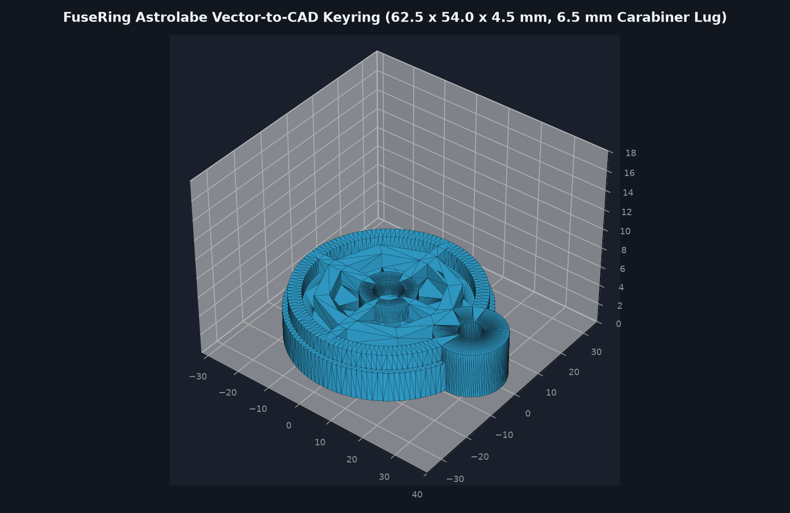

# FuseRing Astrolabe Vector-to-CAD Keyring

Custom 2D SVG vector to 3D parametric CAD keyring modeled with OpenCascade (`build123d`).

- Dimensions: `62.5 mm x 54.0 mm x 4.5 mm` (under the 80x80x6mm maximum).
- Flat bottom base (`Z = 0.0 mm` to `3.0 mm`) with `1.5 mm` raised astrolabe compass vector relief (`Z = 3.0 mm` to `4.5 mm`).
- Reinforced carabiner lug with `6.5 mm` through-hole (`>= 5.0 mm`).

