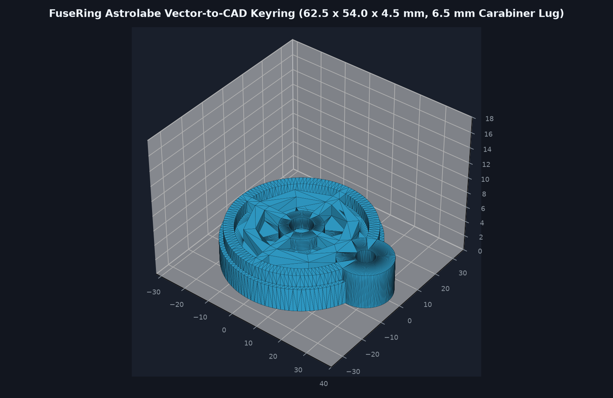

# FuseRing Astrolabe Vector-to-CAD Keyring

Custom 2D SVG vector to 3D parametric CAD keyring modeled with OpenCascade (`build123d`).

Live inspector: https://aariv.me/fusering-compass/

- Dimensions: `62.5 mm x 54.0 mm x 4.5 mm` (under the 80x80x6mm maximum).
- Flat bottom base (`Z = 0.0 mm` to `3.0 mm`) with `1.5 mm` raised astrolabe compass vector relief (`Z = 3.0 mm` to `4.5 mm`).
- Reinforced carabiner lug with `6.5 mm` through-hole (`>= 5.0 mm`).

## DFM and lug mechanics lab

The page includes a deterministic design-for-manufacture lab (`assets/keyring-lab.js`, a pure
ESM module with no DOM, network, clock, or randomness). Everything is recomputed live from
`assets/model.json`:

- Six-process comparator (PLA, PETG, SLA tough resin, SLS PA12, CNC 6061-T6 aluminum, CNC C360
  brass): part mass, lug net section area, bearing / tear-out / net-section safety factors,
  envelope margin, and relief fidelity.
- Load-vs-safety-factor SVG chart sweeping the carabiner pull load (10 N to 150 N) plus a
  z-layer relief mass and cross-section bar chart; all markers and bars are clickable and
  keyboard-focusable.
- One cached canonical SHA-256 (pure-JS FIPS 180-4) stamps the on-page fingerprint and the
  JSON, formula-safe CSV, and Markdown exports identically; verify-digest and one-unit tamper
  demo controls included.
- Fail-closed `#frlab=` URL hash codec restores process and load state across reloads.
- 27 deterministic self-tests run in the page; `npm test` runs 401 `node --test` checks
  (SHA-256 KATs and a 0..160 byte boundary sweep vs Node `crypto`, canonicalization, real
  model geometry cross-checks, lug stress and load monotonicity, hostile codec probes,
  CSV formula-injection escaping, digest parity, and DOM wiring).

